# Hey 👋 I'm Luan

**Developer · GitHub, security, automation, AI & cloud**

_Build useful things, learn in public, and contribute back to the community._

## 🎯⛳ Play Darts Golf

Got 10 seconds? Challenge **me** to a quick **3-hole round** of darts golf. We both throw the same style, and the lowest score wins. One round a day.

| [🛡️ Safe](https://github.com/LuanErasmus/LuanErasmus/issues/new?title=dartsgolf%7Csafe&body=Just+click+%22Create%22+to+throw+your+darts!+Please+don%27t+change+the+title.) | [🔥 Aggressive](https://github.com/LuanErasmus/LuanErasmus/issues/new?title=dartsgolf%7Caggressive&body=Just+click+%22Create%22+to+throw+your+darts!+Please+don%27t+change+the+title.) | [💀 YOLO](https://github.com/LuanErasmus/LuanErasmus/issues/new?title=dartsgolf%7Cyolo&body=Just+click+%22Create%22+to+throw+your+darts!+Please+don%27t+change+the+title.) |
|:---:|:---:|:---:|
| Steady singles | More trebles, more misses | Bullseye or bust |

Pick a style and click **Create**. A bot throws for both of us, posts the head-to-head scorecard, and adds you to the board.

📋 How scoring works

Each hole is a random dartboard number. Par is 3 per hole (9 for the round).

| Hit | Golf result | Strokes |
|:---|:---|:---:|
| 🎯 Bullseye | Hole-in-one | 0 |
| Treble | 🦅 Eagle | 1 |
| Double | 🐦 Birdie | 2 |
| Single | ⛳ Par | 3 |
| Miss | 💨 Bogey | 5 |

<!-- DARTSGOLF:START -->
**⚔️ Players 0 – 0 Luan** (0 draws)

**🏆 Leaderboard** (best 3-hole round, lowest wins)

_No rounds yet. Be the first on the board!_

**🕹️ Latest rounds**

_Nothing yet._

0 round(s) played so far.
<!-- DARTSGOLF:END -->

## 👨‍💻 About Me

I enjoy exploring the GitHub ecosystem, building open-source tools, experimenting with new ideas, and sharing what I learn with the developer community.

Lately I'm focused on **DevSecOps, supply-chain security, Actions automation, Copilot & agentic AI, GitHub Apps and Azure**.

### 🎓 GitHub Certifications

  &nbsp;&nbsp;
  &nbsp;&nbsp;
  &nbsp;&nbsp;
  

Badges link to Microsoft Learn certification details.

## 🤝 Let's Connect

If you're working on **GitHub security, automation, AI, open source or developer tooling**, I'd love to connect, collaborate and learn from what you're building too.

⭐ Enjoyed the game? A star or follow is the best high score you can give me!
